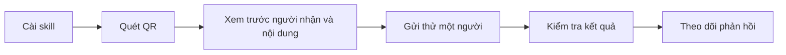

# SlimAI Zalo Agent

Skill cho trợ lý AI cài đặt và vận hành Zalo qua CLI. Bộ cài dành cho Windows, tự chuẩn bị Node.js và thư viện, hướng dẫn đăng nhập QR, gửi text và ảnh, ghi nhật ký từng phần và theo dõi khách phản hồi.

## Bắt đầu

1. Tải [gói ZIP 1.0.0](downloads/slimai-zalo-agent-1.0.0.zip), giải nén và chạy `INSTALL.cmd` trong thư mục `slimai-zalo-agent`.
2. Mở chat mới trong Codex. Nếu skill chưa xuất hiện, khởi động lại ứng dụng.
3. Nhập `Dùng $slimai-zalo-agent giúp tôi bắt đầu.`
4. Làm theo hướng dẫn để quét QR bằng Zalo trên điện thoại.

Không cần cài Zalo PC, Git hoặc Python. Cần Internet để tải runtime và đăng nhập.



## Tài liệu

- [Hướng dẫn trực quan tiếng Việt](references/huong-dan.html) — tải về và mở bằng trình duyệt.
- [Lệnh và tệp kế hoạch](references/operations.md).
- [Nhận phản hồi và kiểm tra theo lịch](references/monitoring.md).
- [Nguồn gốc và giới hạn](references/provenance.md).
- [Biên bản kiểm tra](references/validation-report.md).

## Vận hành

Mặc định runner chỉ xem trước. Gửi thật cần kế hoạch người nhận, nội dung đã được phép và giới hạn số người trong lần chạy. Text được gửi trước ảnh; nếu lỗi hoặc thiếu mã tin, đợt gửi dừng để đối chiếu. Nhật ký ngăn tự thử lại các yêu cầu đã gửi hoặc chưa rõ kết quả.

Khách yêu cầu ngừng nhận được đưa vào danh sách loại trừ. Listener chỉ nhận tin từ danh sách theo dõi được chọn. Trợ lý soạn câu trả lời để người dùng duyệt khi chưa được giao quyền tự trả lời.

Máy phải bật và có mạng để nhận tin. Lịch AI kiểm tra cần được tạo bằng scheduler thật của môi trường.

## Kiểm thử

```powershell
node --test scripts/campaign.test.mjs scripts/monitor.test.mjs scripts/qr.test.mjs
```

8 test đạt trên Windows x64. Lockfile production đã được kiểm tra bằng npm audit ngày 20/11/2026 và không còn cảnh báo đã biết tại thời điểm đó. Chưa đăng nhập hoặc gửi tin thật từ bản skill mới trong quá trình kiểm thử.

Runtime sử dụng SDK Zalo không chính thức; không có cam kết tránh hạn chế tài khoản. Tham gia nhóm không tự động là đồng ý nhận quảng cáo riêng. Chỉ gửi trong phạm vi được người dùng và người nhận cho phép.

## Giấy phép

Skill và phần đóng gói do **SlimAI** duy trì, theo [MIT](LICENSE). Nguồn gốc CLI và thông báo bản quyền của các thành phần nguồn mở được giữ trong [THIRD_PARTY_NOTICES.md](THIRD_PARTY_NOTICES.md).

Gói phân phối không chứa cookie đăng nhập, danh sách khách, ảnh chiến dịch hoặc lịch cá nhân. Dữ liệu vận hành được lưu riêng trong `%LOCALAPPDATA%\SlimAI\ZaloAgent`.
